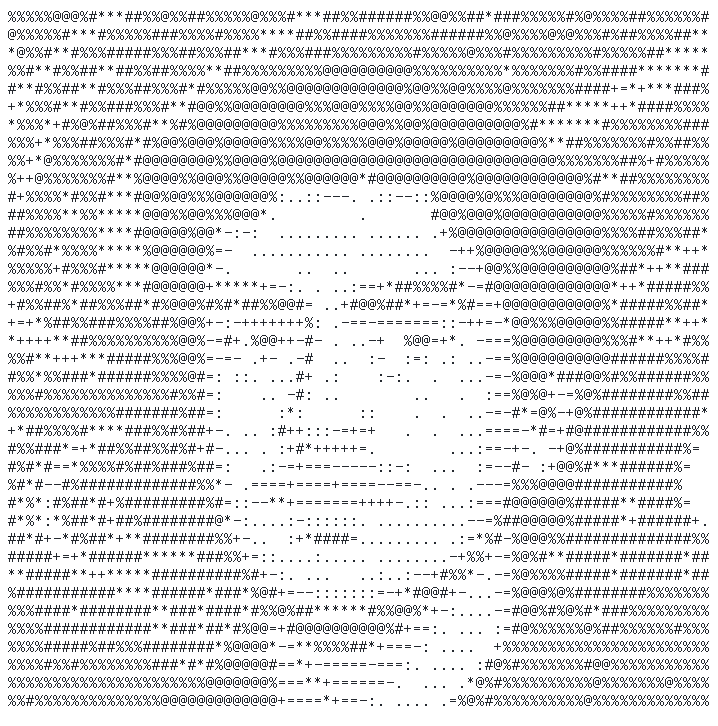

<picture>
  <source media="(prefers-color-scheme: dark)" srcset="assets/portrait-dark.png">
  
</picture>

## Hey, I’m Santiago.

I’m a software engineer exploring new workflows with AI. I care about the small visual details that make interfaces easier to use.

[Read my notes →](https://santychuy.com)

